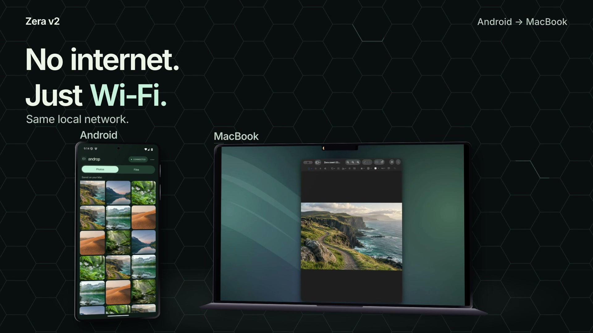
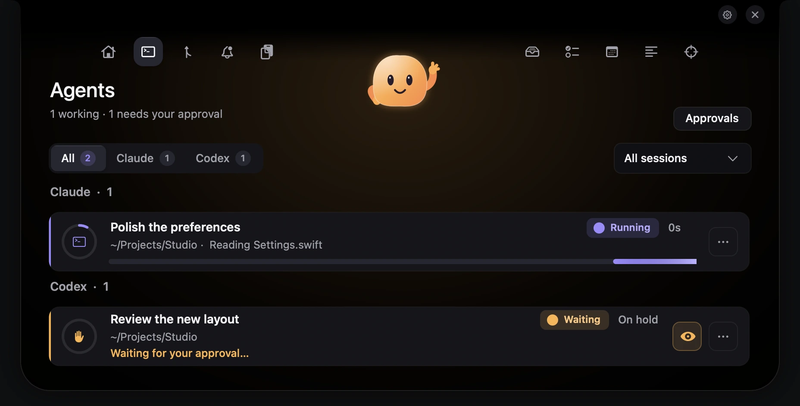
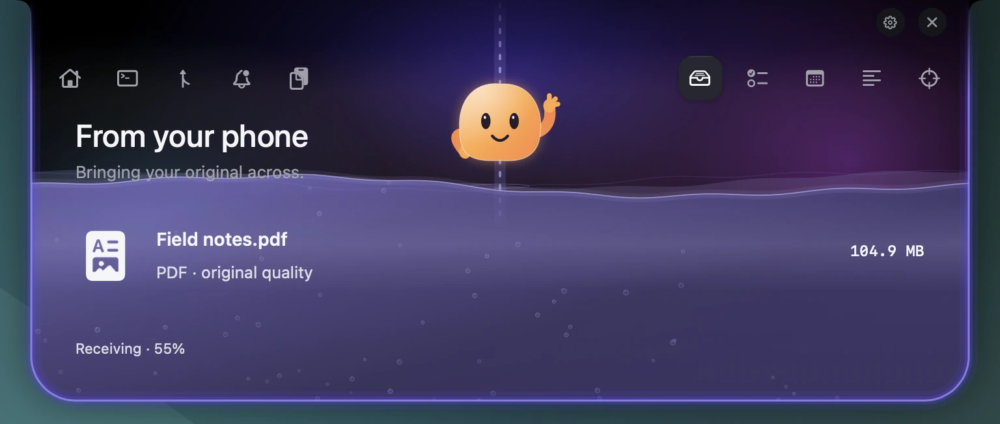
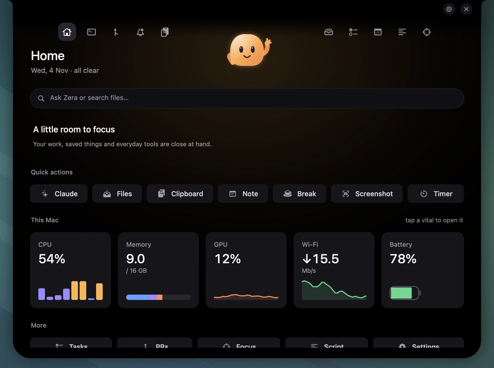
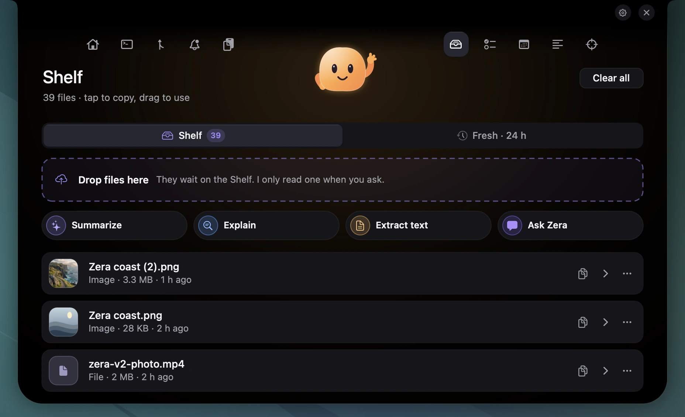

<p align="center"></p>

<h1 align="center">Zera 2</h1>
<p align="center"><b>From your phone. Into your Mac.</b><br>Your agents, files, focus and day — close at hand in a native Mac notch.</p>
<p align="center"><a href="https://github.com/amsynist/zera/releases/latest">Download for Mac</a> · <a href="Androp.apk?raw=1">Download Androp for Android</a> · <a href="https://zera.pravincodes.in/">Website</a> · <a href="site/assets/v2/sharing.mp4">Watch the new film</a></p>

## What’s new in Zera 2

### Android sharing. One picture, across two screens.

Open a photo in **Androp**, glide it off the phone’s edge, and it arrives from the matching edge of your Mac. Original files move directly over **local Wi-Fi or a phone hotspot**. **No internet connection or cloud upload is required.**

Photos and videos travel as the picture itself and open after Zera verifies and saves the original. Other files glide into the notch: Zera catches them, the themed liquid receipt fills with actual progress, and the saved original appears on your Shelf. Filename, size and errors stay readable below the hardware cutout. Zera already contains the receiver — you only need the Android companion on your phone.

**[Download Androp.apk](Androp.apk?raw=1)** · [Pairing and sharing guide](docs/ANDROID_SHARING.md) · [Wire protocol](docs/ANDROID_PROTOCOL.md)

1. Connect phone and Mac to the same trusted Wi-Fi, or connect the Mac to your phone’s hotspot.
2. In Zera’s menu, open **Android sharing** and copy the six-digit pairing code. Enable receiving.
3. Enter the code in Androp’s settings. Use discovery or enter the Mac’s local address.
4. Hold a gallery tile or open a photo, then glide it off an edge. The Files tab sends documents and other originals. **Share → Androp** works too.

Androp’s optional background overlay supports **global drags exported by the source app**. Support varies by app and Android/One UI mode; an in-app Gallery drag is not always a cross-app drag. All four edges work, and direction follows your gesture. Wi-Fi does not locate your Mac’s physical position. Transfers are paired but **unencrypted**; use trusted local networks and keep the receiver off the public internet. Native streaming has no fixed file-size cap; disk, provider and OS limits still apply. Transfer time depends on the file and local connection.

### A complete native redesign

The notch opens into one continuous Obsidian island, with a living companion and consistent controls. Home, Agents, Shelf, Clipboard, Tasks, Pull requests, Reminders, Alerts, Focus and Teleprompter share the same navigation. Optional window arrangements, the app launcher and themed shortcut feedback stay close at hand. No embedded browser UI.

### Claude and Codex, together

Follow current work, requests, tools and results from the Agents screen. Managed sessions can accept replies and approvals; observed desktop sessions are read-only activity. Connect through your own installed tools and logins. Claude plan usage appears when you enable tracking; it is a plan reading, not a made-up task percentage.

### Voice, focus and everyday tools

Hold right **⌥ or ⇧** to dictate with the configured provider. Optional **Murmur** uses an on-device Whisper model after its one-time download. The first use asks for the relevant microphone/speech permissions. Tasks, the focus orb, commit-based timesheets, reminders, water breaks, clipboard history, now playing, weather and optional window layouts round out the day. Some integrations require separate access or setup.

## See the current app

[Watch the sharing film](site/assets/v2/sharing.mp4) · [Watch the complete screen walkthrough](site/assets/v2/walkthrough.mp4)

<table><tr><td></td><td></td></tr><tr><td></td><td></td></tr></table>

These are fresh captures from the v2 Swift UI with fictional demo data. The walkthrough covers every primary screen; the short film shows the phone-to-Mac flow. [Media sources and recording steps](docs/MEDIA.md).

## Install

**Mac:** macOS 13 or newer, Apple silicon or Intel. Download the DMG from [Releases](https://github.com/amsynist/zera/releases), drag Zera to Applications, then open it. A release without Apple notarization may need **System Settings → Privacy & Security → Open Anyway** after the first launch attempt. [Full install/update/uninstall guide](docs/INSTALL.txt).

**Android:** Android 8/API 26 or newer. Download [Androp.apk](Androp.apk?raw=1) and allow installation from your download source. The supplied companion is debug-signed for direct installation. Photo/media, optional Files access, notifications and the edge-overlay permission are explained in the app; choose the features you use.

Quit an older Zera before replacing it, then reopen the updated app. Quit standalone Androp on the Mac before enabling Zera’s receiver: only one receiver can own port 8989. Your existing pairing code is reused when available.

## Setup and privacy

- **Agents:** use your own Claude/Codex tools and login. Installing activity hooks or starting a managed session is explicit. Observed desktop chats remain read-only.
- **GitHub, calendar, weather and audio:** optional integrations request their own access. Tokens are kept in macOS Keychain.
- **Shelf:** stores references; removing an item does not delete the original. File contents go to Claude only when you ask for analysis. Received photos, videos and plain text can open after the verified save.
- **Android sharing:** original bytes and preview metadata stay on the local network. Files save to `~/Downloads/Androp` with collision-safe names, quarantine and byte-count/SHA-256 verification. Only the final verified result means saved.
- **Voice:** on-device Murmur needs a model download. Provider behavior and platform permissions are explained in Settings. Zera has no account, analytics or telemetry service.

See [Security](SECURITY.md), [the data map](docs/PRIVACY_DATA_MAP.md), and [the sharing guide](docs/ANDROID_SHARING.md).

## Build and test

```sh
git clone https://github.com/amsynist/zera.git
cd zera
./build.sh
open dist/Zera.app
swift test
swift test --package-path Packages/AndropKit
```

The Mac app uses Swift, AppKit/SwiftUI, Network.framework and the pinned WhisperKit dependency. `VERSION` defines the local release version; CI can override it with `ZERA_VERSION`. The build uses the project’s stable local signing identity when configured, Developer ID when explicitly supplied, and ad-hoc signing otherwise. Signing alone is not notarization.

The self-contained Android source is in [android/](android/README.md), and the native receiver package in [Packages/AndropKit](Packages/AndropKit). No adjacent private checkout is required to build Zera. [Agent/project guide](AGENTS.md) · [v2 release notes](docs/releases/v2.0.0.md).

## Contributing and credits

[Contributions](CONTRIBUTING.md), issues and focused pull requests are welcome. Built by [amsynist](https://github.com/amsynist), with help from [contributors](https://github.com/amsynist/zera/graphs/contributors).

Code is [MIT](LICENSE). Zera’s identity and original creative assets have [separate terms](LICENSE-ASSETS.md). Film music: **Sascha Ende, [ende.app](https://ende.app/), CC BY 4.0**; motion accents are CC0 where used. [Third-party notices](THIRD_PARTY_NOTICES.md).

Zera is independent and is not affiliated with Anthropic, OpenAI, GitHub, Apple or Samsung. Their names and marks belong to their owners.
