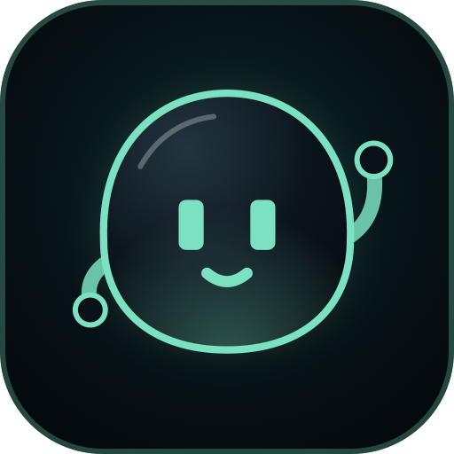
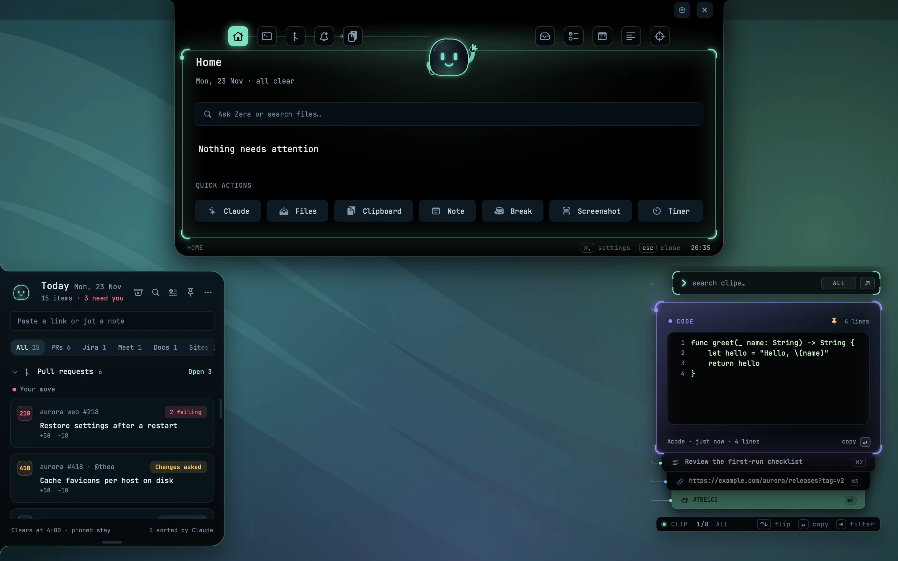
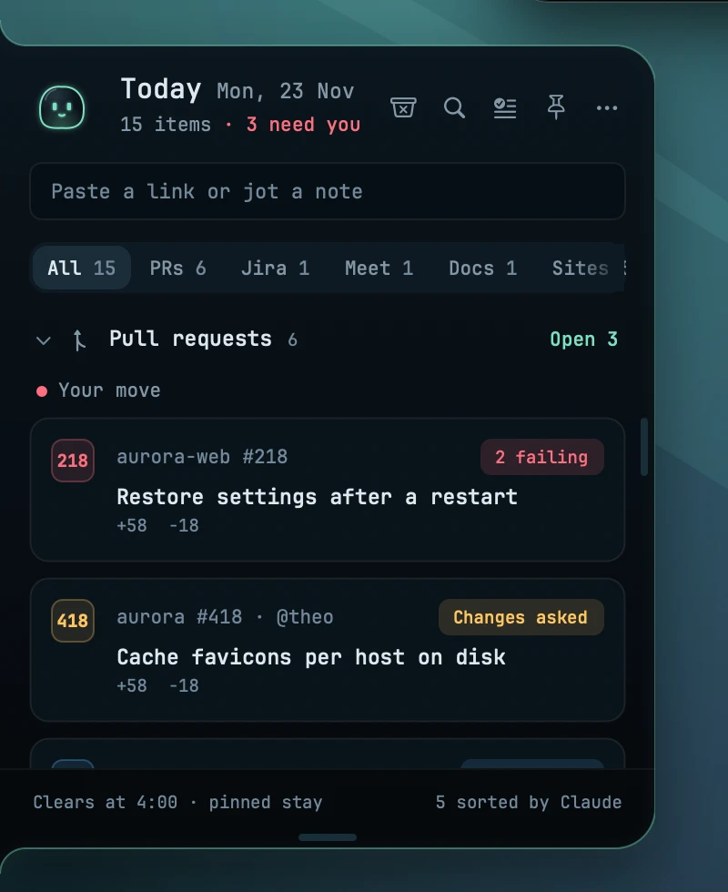
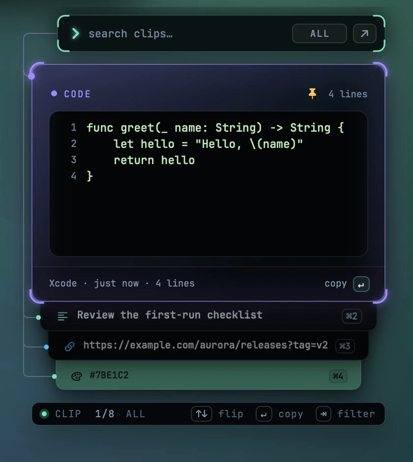

<p align="center"></p>
<h1 align="center">Zera v2</h1>
<p align="center"><strong>Your Mac’s notch, wired for work.</strong><br>Claude and Codex sessions, today’s links, your clipboard, files, tasks and focus, one glance away.</p>
<p align="center">
  <a href="https://github.com/amsynist/zera/releases/latest"></a>
  
  <a href="LICENSE"></a>
</p>
<p align="center"><a href="https://github.com/amsynist/zera/releases/latest"><strong>Download for Mac</strong></a> · <a href="https://zera.pravincodes.in/">Try the live notch in your browser</a> · <a href="#build-from-source">Build from source</a></p>

[](https://zera.pravincodes.in/)

<p align="center"><sub>A native capture of the app with sample data: the notch, Daily Shelf and the Clipboard deck on one screen.</sub></p>

## What Zera is

Zera is a native macOS app that lives in the notch (or the centre of the menu bar on a Mac without one). Open it and you get a rail of ten screens around a small companion. Close it and it stays out of the way until something needs you.

It is written in Swift with AppKit and SwiftUI, keeps your data on your Mac, and has no account and no telemetry.

## Features

| | |
| --- | --- |
| **Agents**<br>Claude and Codex in one list. A running session shows as two wings beside the notch. Sessions Zera manages take replies and approvals; desktop chats it only observes are read-only.<br><br> | **Daily Shelf**<br>Paste a pull request, ticket, doc or note. The shelf files links it recognises and waits at the edge of your screen. Connect GitHub to see checks and reviews for the PRs you saved.<br><br> |
| **Clipboard deck**<br>Your Clipboard shortcut opens a deck of cards beside the pointer. Flip with the arrow keys, press Return to copy, or use ⌘1–9. History stays on your Mac.<br><br> | **Pull requests**<br>Reviews, checks and approvals from your GitHub account, with every status spelled out in words.<br><br> |

More on the rail:

- **Launcher and App Shortcuts.** `⌥ Space` raises a launcher from the bottom of the screen: type to find an app, or type `>` for commands (Wallpaper, Theme, Lock, Sleep, Quit All, Kill Process, Kill Port and Zera’s own actions). `>wallpaper` shows your pictures as a strip, previews each one on the desktop as you move through them and sets one only when you press Return; `>folders` chooses where the pictures come from. The launcher is the default of four looks: Minimal, Tree and Orbit stay in Settings › General › Opener style. Its flow is inspired by [Caelestia shell](https://github.com/caelestia-dots/shell). App Shortcuts is an optional extra that gives an app its own keys. Zera opens and focuses apps; it does not move windows. [Guide](docs/APP_SHORTCUTS.md)
- **Tasks, timesheets and Focus.** Add a task from anywhere with `⌥ ⌘ T`, focus on one at a time, and export a range to Excel, CSV or text.
- **File Shelf.** Carry any file, picture or video up to the notch and the Shelf opens to catch it; drag it out later. Zera reads a file only when you ask about it.
- **Reminders, Alerts and Teleprompter.** Your calendars in one day view, one inbox for what needs you, and a script that rolls beside the camera.
- **Dictation.** Hold right `⌥` or `⇧` to dictate with Apple speech or on-device Murmur. Murmur loads when used and releases its model after one idle minute. **Settings → Features → Voice** can unload it immediately.
- **Signal interface.** One monospaced face, a lit trace from Zera to the open screen, nine colour themes, solid or translucent. [Themes](docs/THEMES.md) · [Design reference](docs/design/signal/COMPONENTS.md)
- **Zera X.** Send original photos and files over local Wi-Fi and review Claude Code approvals from Android or a paired Wear OS watch. [Pairing and setup](docs/ZERA_X_APPROVALS.md).

The [website](https://zera.pravincodes.in/) has a live, clickable recreation of the notch, the Daily Shelf, the Clipboard deck and all four looks of the launcher. Release notes are in [docs/releases](docs/releases).

## Install

1. Download the DMG from the [latest release](https://github.com/amsynist/zera/releases/latest).
2. Open it and drag Zera to Applications.
3. Launch Zera. If the build is not notarized, macOS asks you to allow it under **System Settings → Privacy & Security → Open Anyway**.

Zera needs macOS 13 or later and runs on Apple silicon and Intel. To update, quit Zera before replacing it. [Install, update and uninstall guide](docs/INSTALL.txt)

### Default shortcuts

| Keys | Action |
| --- | --- |
| `⌥ Space` | Launcher (type `>` for commands) |
| `⌃ Space` | Daily Shelf |
| `⌥ ⌘ T` | Add a task |
| Right `⌥` or `⇧`, held | Dictation |
| Your choice | Clipboard deck, set in **Settings → Clipboard** |

Every shortcut can be changed or turned off in Settings.

## Android sharing

Zera X, formerly Androp, is the Android companion. Glide a photo off the edge of your phone and it arrives on the Mac as the original. Documents drop into the notch, where a liquid receipt shows progress, and then wait on the File Shelf.

1. Put your phone and Mac on the same trusted Wi-Fi, or use your phone’s hotspot.
2. Turn on receiving in Zera and choose **Extras → Android sharing → Show pairing QR** from the menu bar, or open **Settings → Extras**. In Zera X, tap **Scan pairing QR**. Older APKs can enter the displayed Mac IP address and six-digit code separately.
3. Send from Zera X’s gallery or Files tab, or use **Share → Zera X** from another app.

Transfers stay on your local network. They are paired but not encrypted, and a file counts as saved only after its SHA-256 is verified. Zera X needs Android 8 or later. [Download Zera X for Android](Androp.apk?raw=1) · [Pairing guide](docs/ANDROID_SHARING.md) · [Protocol](docs/ANDROID_PROTOCOL.md) · [Watch the sharing film](https://zera.pravincodes.in/#sharing)

## Privacy

- Zera has no telemetry service and no account.
- Clipboard history, tasks, notes and shelf references stay on your Mac. Integration tokens are stored in the macOS Keychain.
- Claude and Codex run through the tools and logins you already have. Live activity hooks and managed sessions are enabled separately.
- A file is sent to your chosen provider only when you ask about it. Optional Daily Shelf sorting sends link URLs and titles, never your notes.
- Murmur dictation runs on a local Whisper model after a one-time download.

Details are in the [privacy data map](docs/PRIVACY_DATA_MAP.md) and the [network data flow](docs/NETWORK_DATA_FLOW.md). Report security issues through [SECURITY.md](SECURITY.md).

## Build from source

You need macOS 13 or later and the Xcode Command Line Tools.

```sh
git clone https://github.com/amsynist/zera.git
cd zera
./build.sh
open dist/Zera.app
```

Run the checks:

```sh
swift test                                    # app
swift test --package-path Packages/AndropKit  # Android receiver
node scripts/check-site.mjs                   # website
```

Local builds read the version from `VERSION`. Release builds take it from the release tag.

### Project layout

| Path | What is there |
| --- | --- |
| `Sources/Zera` | The app: island, screens, Daily Shelf, Signal interface |
| `Packages/AndropKit` | The in-process Android receiver |
| `android` | Androp, the Android companion ([README](android/README.md)) |
| `site` | The website, including the live demos |
| `docs` | Guides, design references and release notes |
| `Tests` | Unit tests and opt-in render tests |

[AGENTS.md](AGENTS.md) is the project guide for contributors and coding agents.

## Contributing

Bug reports, integrations, accessibility improvements and fixes are welcome. Read [CONTRIBUTING.md](CONTRIBUTING.md) first, and open an issue before starting a larger change.

## License and credits

Code is released under the [MIT license](LICENSE). Zera’s original artwork has [separate terms](LICENSE-ASSETS.md). JetBrains Mono is used under the SIL Open Font License. Film music is by Sascha Ende (CC BY 4.0) and Daily Shelf sound effects are by Kenney (CC0). The launcher’s flow (a list over a bottom search field, `>` for commands, the wallpaper strip) is inspired by [Caelestia shell](https://github.com/caelestia-dots/shell) for Hyprland; it is written from scratch for macOS and uses none of Caelestia’s code. See [media credits](docs/MEDIA.md) and [third-party notices](THIRD_PARTY_NOTICES.md).

Zera is an independent project and is not affiliated with Anthropic, OpenAI, Apple, GitHub or Samsung.
