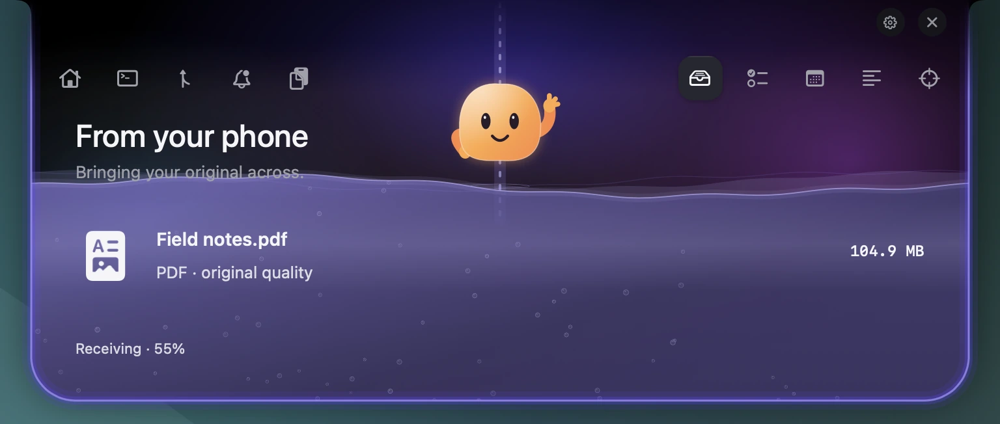
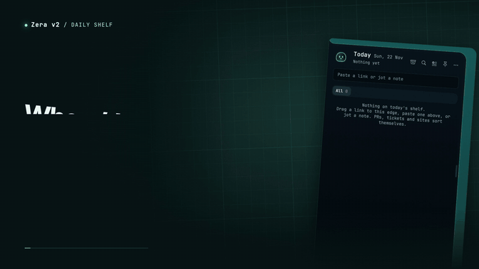
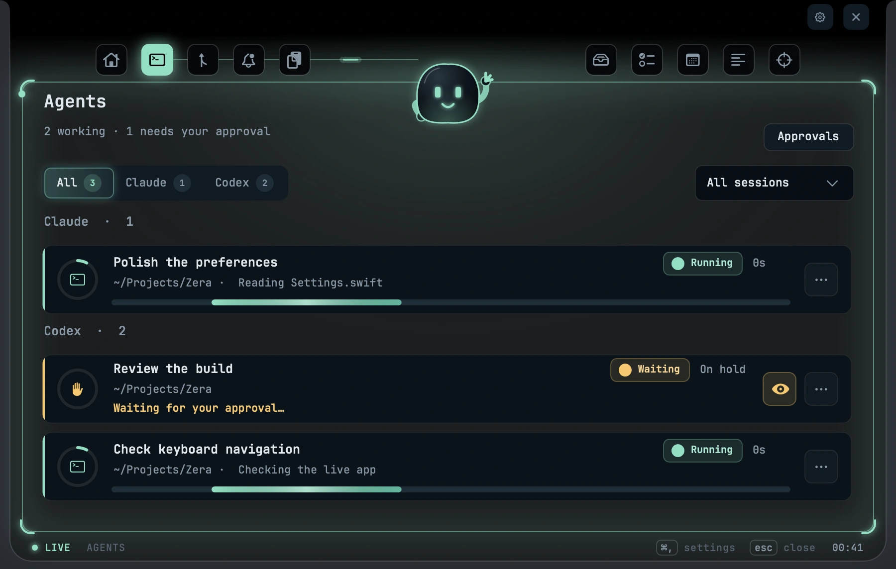
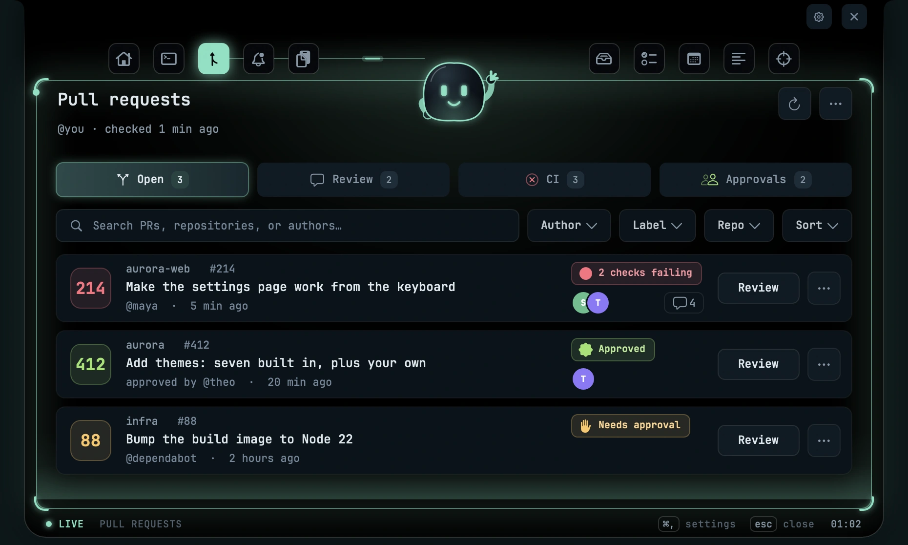
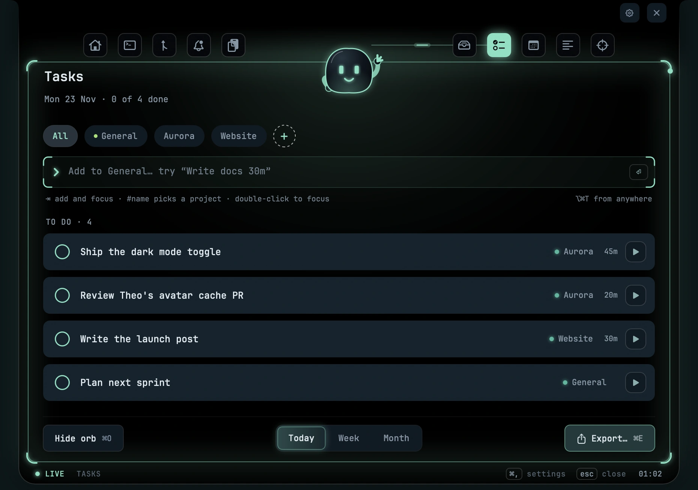
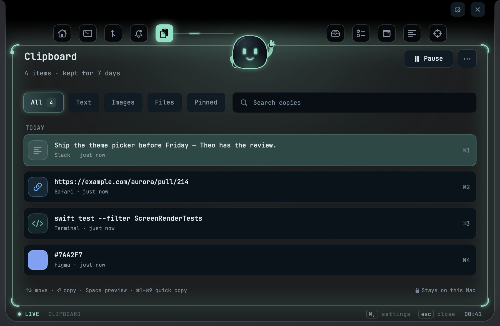
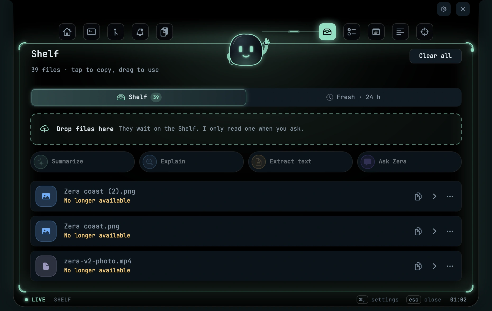
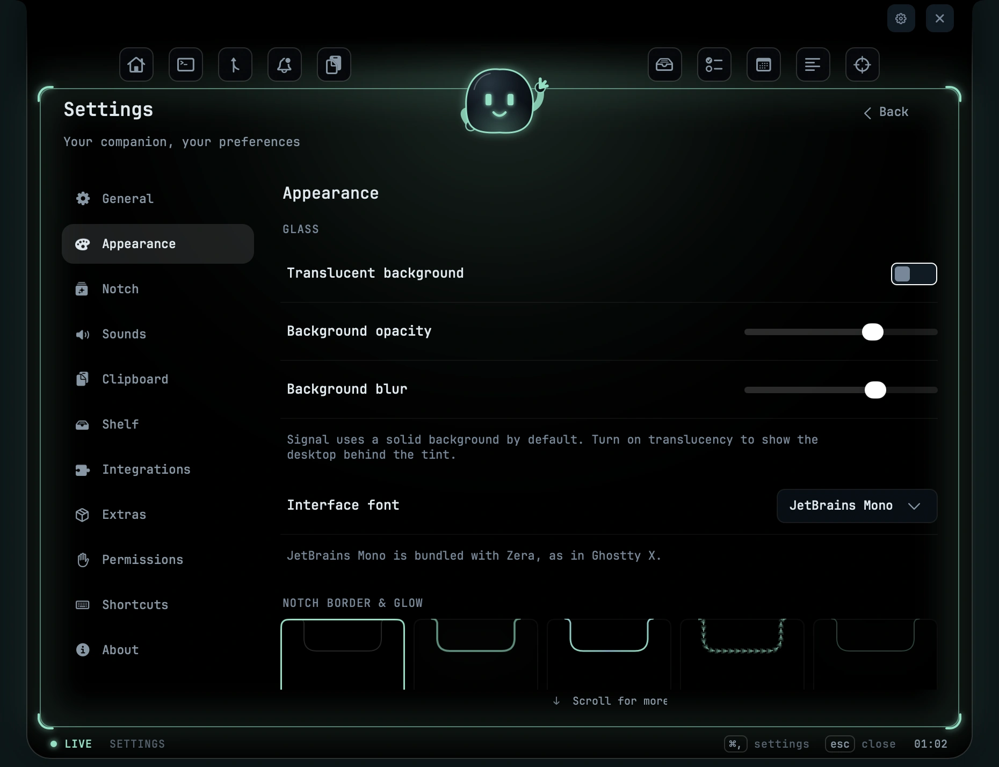

<h1 align="center">Zera v2</h1>
<p align="center"><strong>Send originals from Android to your Mac over local Wi-Fi.</strong><br>Zera also keeps Claude, Codex, files, tasks and focus in one native notch.</p>
<p align="center"><a href="https://github.com/amsynist/zera/releases/latest">Download for Mac</a> · <a href="Androp.apk?raw=1">Download Androp for Android</a> · <a href="https://zera.pravincodes.in/">Website and demos</a></p>

## Android sharing

Glide a photo off the edge of your phone in Androp and it arrives from the matching edge on the Mac. Zera verifies the original before it opens. Documents glide into the notch, where a liquid receipt shows progress as the bytes arrive. The saved file appears on your Shelf.

1. Connect your phone and Mac to the same trusted Wi-Fi or your phone’s hotspot.
2. Enable receiving in Zera’s **Extras → Android sharing**, then enter the pairing code in Androp.
3. Send from Androp’s gallery or Files tab, or use **Share → Androp** from another app.

The optional Android edge overlay works with apps that export a global drag. Transfers are paired and unencrypted on your local network. [Watch the 20-second sharing film](https://zera.pravincodes.in/#sharing-film) · [Pairing guide](docs/ANDROID_SHARING.md)

[](https://zera.pravincodes.in/#sharing-film)

## New in Zera v2.1.0

**Daily Shelf** keeps the links you save at the edge of your Mac. Paste a pull request, ticket or doc, add a note, and pin anything you want to carry forward. Connect GitHub to see checks and reviews on the PRs you saved. Adjust placement, categories and sorting in **Settings → Shelf**.

<a href="https://zera.pravincodes.in/#daily-shelf">
  <picture>
    <source media="(prefers-reduced-motion: reduce)" srcset="site/assets/v2/daily-shelf/poster.jpg">
    
  </picture>
</a>

[Play the 22-second Daily Shelf film with audio and captions](https://zera.pravincodes.in/#daily-shelf) · [Zera v2.1.0 release notes](docs/releases/v2.1.0.md)

## Inside the notch

The **Signal** interface uses solid backgrounds by default. Turn on **Translucent background** in **Settings → Appearance** to use a tinted desktop backdrop. Agents shows Claude and Codex activity. Managed sessions accept replies and approvals, and observed desktop chats display activity. Use the file Shelf for dropped or received files, Clipboard for copied text and links, Tasks for work and timesheets, and Pull requests for reviews and checks.

| Agents | Pull requests |
| --- | --- |
|  |  |
| **Tasks** | **Clipboard** |
|  |  |
| **File Shelf** | **Settings** |
|  |  |

Home also opens Focus, Reminders, Alerts and Teleprompter. Hold right **⌥ or ⇧** to dictate with your chosen provider. Murmur uses a local Whisper model after its one-time download. Enable **App Shortcuts** in Settings → Extras to open or focus apps with your own keys.

[Explore all 14 screens](https://zera.pravincodes.in/#screens) · [Watch the original Zera v2.0 walkthrough](https://zera.pravincodes.in/#tour) · [App Shortcuts guide](docs/APP_SHORTCUTS.md) · [Media and recording notes](docs/MEDIA.md)

## Install

- **Mac.** macOS 13+ on Apple silicon or Intel. Open the DMG, drag Zera to Applications, and launch it. For builds without notarization, macOS may require **System Settings → Privacy & Security → Open Anyway** after your first launch attempt. [Mac downloads](https://github.com/amsynist/zera/releases/latest) · [Install, update and uninstall guide](docs/INSTALL.txt)
- **Android.** Android 8+. Install the debug-signed APK and allow installation from your download source. [Download Androp.apk](Androp.apk?raw=1)
- **Updating.** Quit Zera before replacing it. Quit standalone Androp on the Mac before enabling Zera’s receiver. The receiver reuses your existing pairing code when available. [Android sharing guide](docs/ANDROID_SHARING.md)

## Setup and privacy

- Use your installed Claude and Codex tools and logins. Live activity hooks and managed sessions are enabled separately.
- Optional Daily Shelf sorting sends saved link URLs and titles to Claude. Daily Shelf uses your existing GitHub connection for PRs you saved. Disable Daily Shelf in **Settings → Shelf**.
- The file Shelf stores references to originals. Choosing file analysis sends the selected file to your configured provider. Received originals save to `~/Downloads/Androp` after size and SHA-256 verification.
- Zera stores integration tokens in macOS Keychain and has no telemetry service. [Privacy data map](docs/PRIVACY_DATA_MAP.md) · [Security](SECURITY.md)

## Build and test

```sh
git clone https://github.com/amsynist/zera.git
cd zera
./build.sh
open dist/Zera.app
swift test
swift test --package-path Packages/AndropKit
node scripts/check-site.mjs
```

Zera uses AppKit, SwiftUI, Network.framework and pinned WhisperKit. Local builds use `VERSION` by default. CI takes the published bundle version from its release tag. [Android source](android/README.md) · [Receiver package](Packages/AndropKit) · [Project guide](AGENTS.md)

Code is [MIT](LICENSE). Zera’s original artwork has [separate terms](LICENSE-ASSETS.md). Film music by Sascha Ende (CC BY 4.0) and Daily Shelf sound effects by Kenney (CC0). [Media credits](docs/MEDIA.md) · [Third-party notices](THIRD_PARTY_NOTICES.md) · [Contributing](CONTRIBUTING.md)
